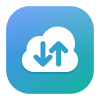
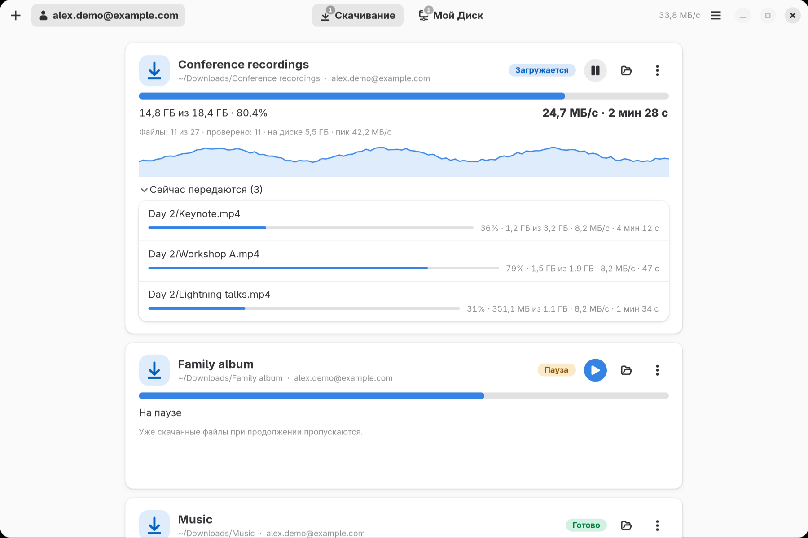
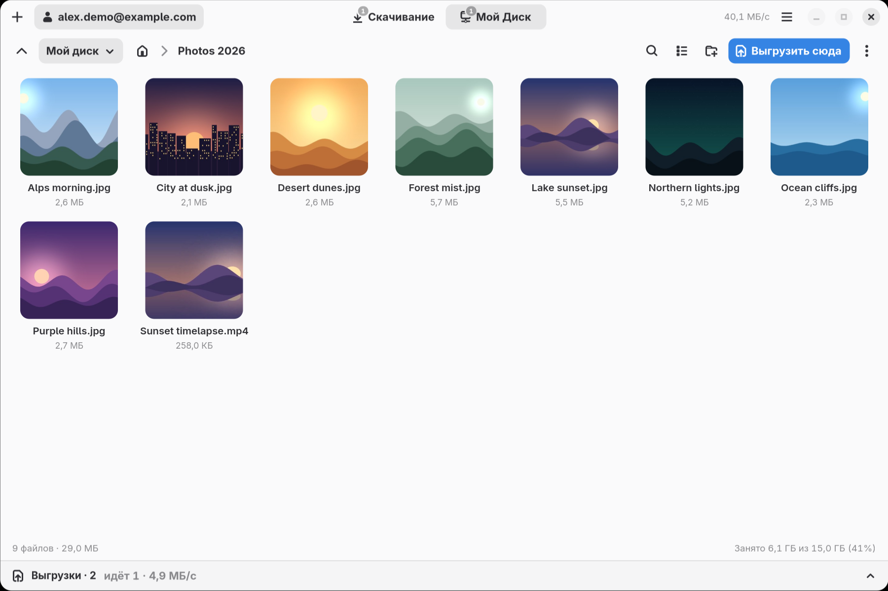
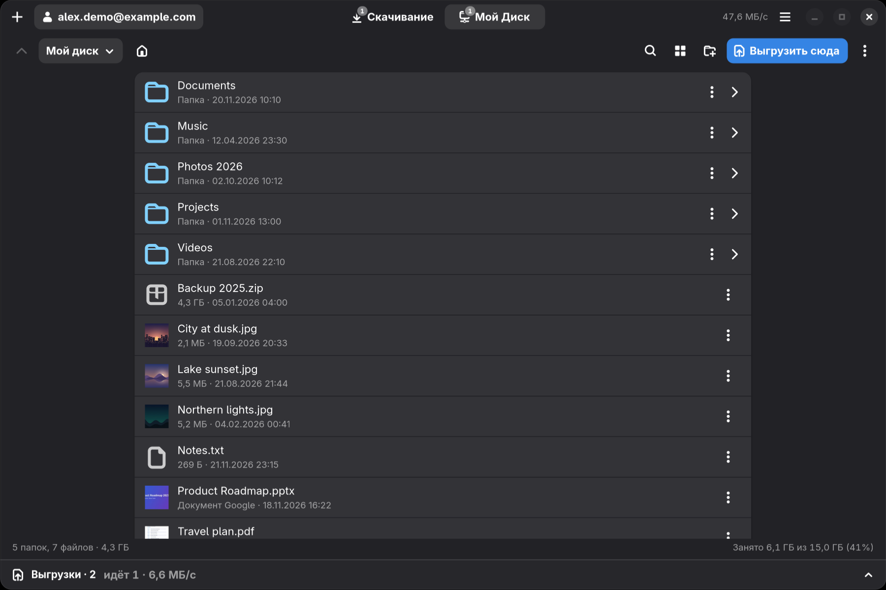
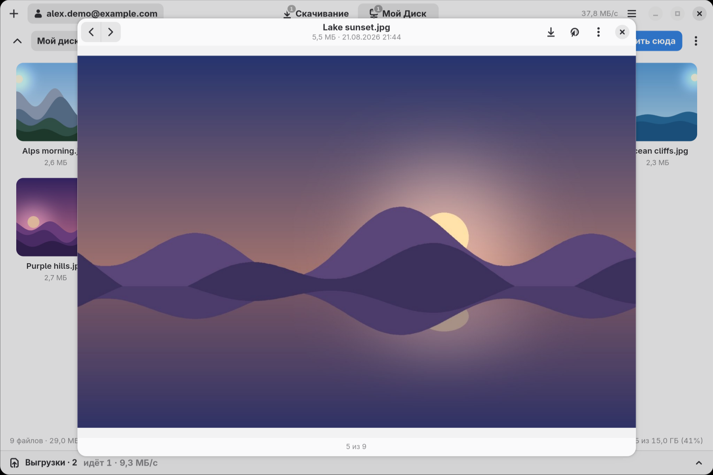
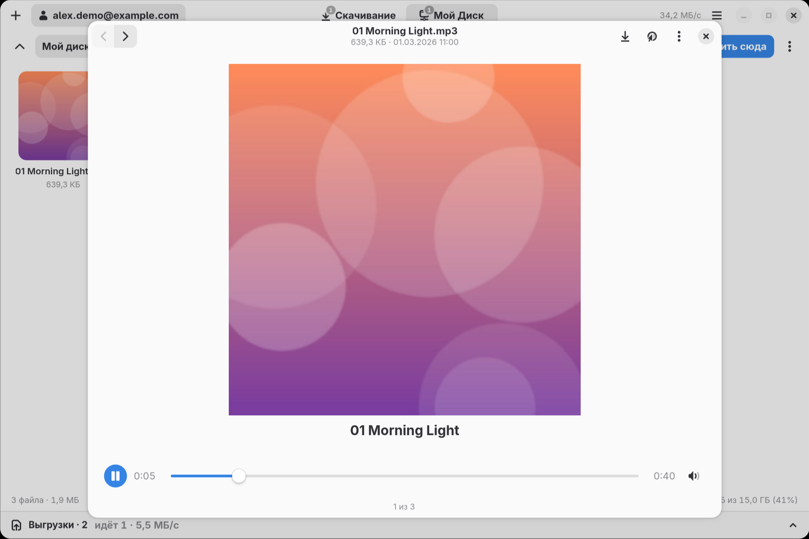
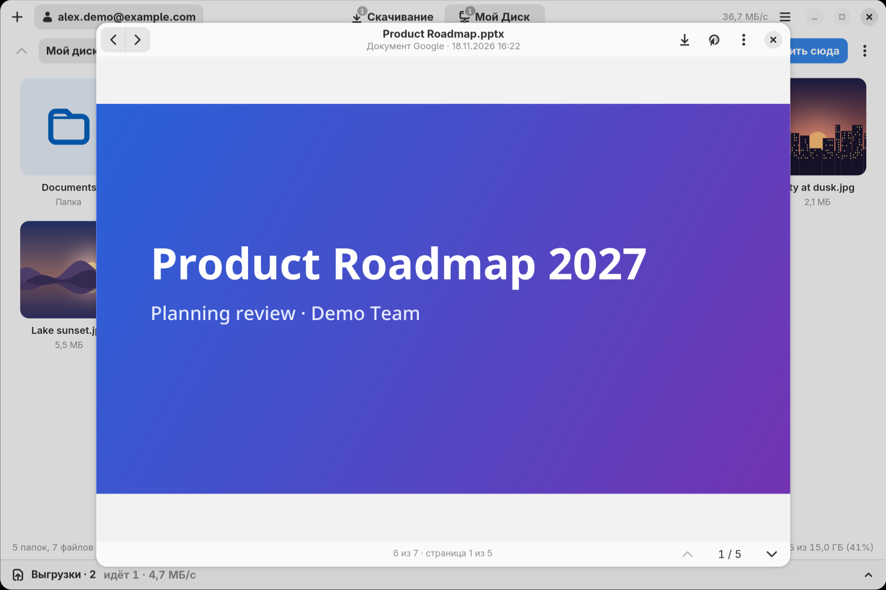
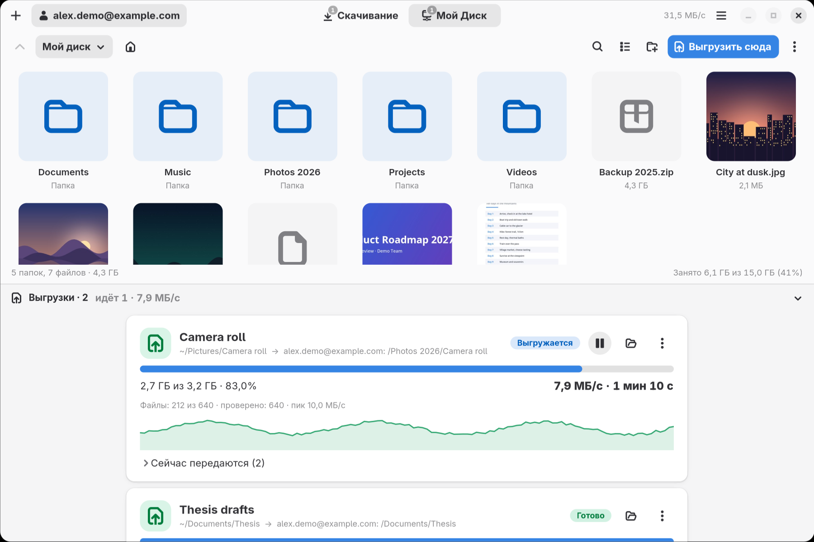

<p align="center">
  
</p>

<h1 align="center">Drive Loader</h1>

<p align="center">
  <b>A GTK4 / libadwaita desktop app for big Google Drive transfers, built on rclone.</b><br>
  Download whole folders, upload from your PC and browse your Drive. Transfers keep running when the window is closed and continue after a reboot.
</p>

<p align="center">
  
</p>

---

## Why

The Google Drive web UI zips big folders into many archives. The zips often fail, and nothing resumes after a crash or reboot.
`rclone` does the job well, but you have to type long commands and watch a terminal.
Drive Loader adds a native Linux front‑end:

- each transfer runs as its own **systemd user unit**, so it does not depend on the window;
- the app shows **live progress from rclone's remote‑control API**;
- unfinished jobs **resume at the next login**.

## Features

### Transfers
- **Download** a folder or a single file from a Drive link, a file ID or the built‑in browser.
- **Upload** folders and files to any Drive folder. You can drag and drop them onto the window.
- Every job is a transient `systemd --user` unit. Closing the window or logging out of the GUI does not stop it.
- **Resume after reboot**: an optional `driveloader-resume.service` restarts unfinished jobs at login once the network is up.
- **Large files resume where they stopped.** Half‑downloaded files continue over HTTP Range and are checked by MD5, so a 4 GB file does not start over.
- Live cards for each job:
  - progress, speed and ETA;
  - a 2‑minute speed sparkline and the peak speed;
  - files done and checked, size on disk;
  - an expandable list of files in flight.
- Pause and resume a single job or all jobs. Set a bandwidth limit per job. Choose parallel transfers. Re‑check and fill gaps.
- Clear error messages, e.g. Drive quota or rate limit hit, sign‑in expired, folder not shared with you, plus a per‑job log.

### Drive browser
- **My Drive** and **Shared with me**, with breadcrumbs, sorting and search.
- **List and grid views** (<kbd>Ctrl</kbd>+<kbd>G</kbd>) with real thumbnails, cached on disk.
- File actions: new folder, rename, move, move to trash, folder size, copy link, open in the browser, download, upload here.
- Uploads drawer (“Uploads · N”) under the browser, so uploads stay visible while you work.

### Preview (double‑click or <kbd>Enter</kbd>; <kbd>←</kbd>/<kbd>→</kbd> to flip)
- **Images** at full resolution.
- **Text and code** files.
- **Audio** with cover art and tags. Audio streams through a local proxy, so seeking works without downloading the whole file.
- **Video** (with `gst-plugin-gtk4`).
- **PDF**, **Google Docs, Sheets and Slides** (exported to PDF), and **Office files** (with LibreOffice), shown page by page.

### Accounts and desktop
- **Multiple Google accounts.** Each one is a regular rclone `drive` remote, so your existing rclone setup just works.
- Read‑only or full‑access sign‑in. The app asks for write access only when you first rename, upload or trash something.
- **Your own Google API key** wizard. rclone's shared client ID is heavily rate‑limited, which makes listings slow. The wizard walks you through creating your own key in Google Cloud Console and signs every account in again.
- Clear “sign‑in expired” handling. Jobs that failed for that reason continue on their own after you sign in again.
- **System tray icon** (StatusNotifierItem):
  - shows a progress state;
  - its menu lists the jobs and has pause all / resume all.
- Optional start in the tray at login.
- Desktop notifications when a job finishes or fails.
- Follows the system light or dark style.

## Screenshots

| | |
|---|---|
|  |  |
|  |  |
|  |  |

<sub>All screenshots use a mock Drive with placeholder files. No real account is shown.</sub>

## Requirements

| Package (Arch name) | Needed for |
|---|---|
| `python` ≥ 3.10, `python-gobject` | the app |
| `gtk4`, `libadwaita` ≥ 1.5 | the UI |
| `rclone` | all transfers and listings |
| `systemd` (user session) | background jobs and resume after reboot |
| `poppler-glib` | *optional:* PDF and Google Docs preview |
| `gst-plugins-base`, `gst-plugins-good`, `gst-libav` | *optional:* audio preview |
| `gst-plugin-gtk4` | *optional:* video preview |
| `libreoffice-fresh` (or `-still`) | *optional:* preview of .docx / .xlsx / .pptx stored as files |

Debian/Ubuntu: `python3-gi gir1.2-gtk-4.0 gir1.2-adw-1 rclone gir1.2-poppler-0.18 gstreamer1.0-plugins-good gstreamer1.0-libav gstreamer1.0-gtk4`.
Fedora: `python3-gobject gtk4 libadwaita rclone poppler-glib gstreamer1-plugins-good gstreamer1-plugin-gtk4`.

## Install

```sh
git clone https://github.com/Teiwazik/drive-loader.git
cd drive-loader
./install.sh
```

This puts the app into `~/.local` and needs no root. To remove it, run `./install.sh --uninstall`. Your jobs and settings in `~/.config/driveloader` are kept.

## Usage

1. Start **Drive Loader** from the app menu.
2. Press **Add account** and sign in with Google in the browser. This creates an rclone remote for you. Remotes you already have in `rclone config` show up on their own.
3. In the **Downloads** tab, paste a folder or file link, or pick a folder in the **My Drive** tab and press *Download*.
4. Close the window whenever you like. The tray icon shows progress, and jobs go on in the background.

To have jobs continue after a reboot, turn on **Resume transfers after login** in the settings.

Command line:

```sh
driveloader            # open the window
driveloader --hidden   # start in the tray only
driveloader --resume   # restart unfinished jobs without the GUI (what the login service runs)
```

Job state lives in `~/.config/driveloader/`, and logs in `~/.local/state/driveloader/`.
You can also watch a job with `systemctl --user status 'driveloader-*'`.

> [!NOTE]
> The interface is in **Russian** for now. Translations are welcome.

## How it works

- **Downloads:** `rclone copy` with `--rc`, so the app polls `core/stats` on a local port.
  - The app first resumes partly downloaded large files itself, over the Drive API with Range requests and an MD5 check.
  - rclone then skips the files that are already done.
- **Uploads:** `rclone copy` in the other direction.
- **Browser and preview:** the Drive v3 API, with the same OAuth token as the rclone remote.
  - Media is streamed through a small proxy on `127.0.0.1`, so GStreamer can seek.
- The app never sends your token anywhere except `googleapis.com`.

## License

[MIT](LICENSE)
